# orbits

A 7-track **Euclidean sequencer** for [norns](https://monome.org/docs/norns/), played from a **Novation Launchpad Mini MK3**.

Every track has its own length, density, rotation and clock division, so tracks drift against each other (polymeter and polyrhythm are free). On top of the Euclidean pattern you get hand-placed steps, accents, per-step probability and micro-timing, a note repeater, an accent groove, a scale-aware keyboard with arpeggiator and melodic phrases, random modulation of eight parameters, 32 patterns per track and a song chain.

The Launchpad is where you play; the norns screen and encoders hold the fine adjustments.

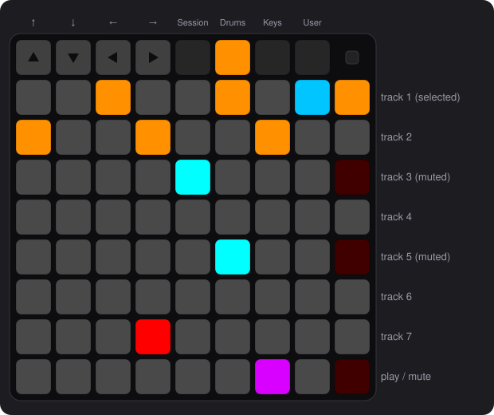

- [Requirements and install](#requirements-and-install)
- [Quick start](#quick-start)
- [How it is organised](#how-it-is-organised)
- [Drums page](#drums-page): rhythm
- [Keys page](#keys-page): notes, scale, arp, phrase
- [User page](#user-page): random modulation
- [Session page](#session-page): patterns and song chain
- [Playing: tracks, mute, tempo](#playing-tracks-mute-tempo)
- [Saving](#saving)
- [Voices and MIDI](#voices-and-midi)
- [Reference](#reference)
- [Troubleshooting](#troubleshooting)
- [Contributing](#contributing)

## Requirements and install

- norns (2.7 or later) with a Novation **Launchpad Mini MK3** plugged in over USB. Other Launchpads are not supported.
- The [**lp3**](https://github.com/CyberDuck79/lp3) mod, which drives the Launchpad. From maiden:

  ```
  ;install https://github.com/CyberDuck79/lp3
  ```

  Then enable **LP3** in **SYSTEM > MODS** and restart the norns.
- A sound source for each track: an external instrument on a MIDI port is enough, nothing else to install. If you want internal synths, install [nb](https://github.com/sixolet/nb) voice mods too. See [Voices and MIDI](#voices-and-midi).

Install orbits itself by cloning this repository into the norns' script folder, so that the script ends up in `~/dust/code/orbits`:

```
cd ~/dust/code
git clone https://github.com/CyberDuck79/orbits.git orbits
```

## Quick start

1. Load **orbits**. The Launchpad lights up on the **Drums** page.
2. Open **PARAMETERS** and give each track a voice with **T1 OUTPUT … T7 OUTPUT**. A track with no voice is silent.
3. On the Drums page, track 1 is selected (right column, top button). Press the **play** button (bottom of the right column) to start.
4. Change the rhythm: the **↑ ↓** buttons add or remove pulses, **← →** rotate the pattern.
5. Press **Keys** (top row) to choose the notes, then **Drums** to come back.
6. Select another track with the right-column buttons and give it its own length and division.

Pressing play again stops the sequencer and rewinds every track to its first step.

When the script loads, the screen plays a short animation: seven rings, one per track, each with its own length, drift apart like orbits and snap back together before the name appears. The script is already running behind it; turn an encoder or press a key to skip it.

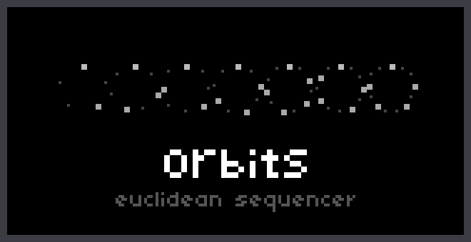

## How it is organised

### The Launchpad

```
        ↑   ↓   ←   →  Session Drums Keys User    ●
      ┌────────────────────────────────────────┐
      │                                        │   T1
      │                                        │   T2
      │           8 × 8 grid                   │   …
      │       (depends on the page)            │   T7
      │                                        │
      └────────────────────────────────────────┘  play / mute
```

- **Top row, right half**: the four pages. The lit one is the current page.
- **Top row, left half**: the arrows. They are lit on the Drums, Keys and Session pages, where they do something (see below).
- **Right column**: the 7 tracks (top = track 1). The selected track is amber, a muted one is red. Everything you edit applies to the selected track.
- **Bottom of the right column** (the *Stop Solo Mute* button): **tap** to play / stop. **Hold** it to mute tracks and to change the tempo (see [Playing](#playing-tracks-mute-tempo)).
- **Logo (top right corner)**: flashes on every quarter note while playing.
- **The 8 × 8 grid**: its meaning depends on the page. Each row is one parameter.

### The norns screen and encoders

The screen never repeats what the Launchpad already shows. It carries what the pads cannot: the numeric values and the fine adjustments.

- **E1** cycles through the *sub-pages* of the current page. The small markers at the top right show where you are, and the sub-page's name sits next to them. On the Drums page the first marker stands for the special *step* sub-page: a single pixel normally, a blinking white square while it is up. The Drums page also jumps to a sub-page when you touch certain pads (see below).
- **E2 / E3** (knobs) and **K2 / K3** (keys) are laid out as the screen shows them: the left column belongs to E2 (round dot) and K2 (square), the right column to E3 and K3. A **filled square** means a switch is on, a hollow one off. A `--` means that control does nothing right now.
- The **bottom half** of the Drums and Keys pages shows the values of the pad rows. The small icon to the left of each one shows which row of the page it belongs to.
- **K1** is not used.

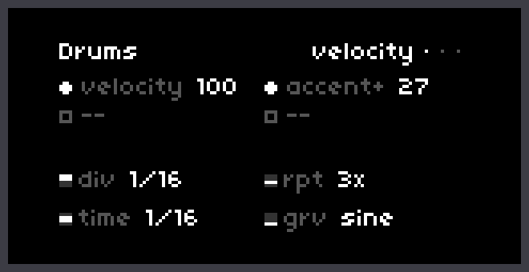

## Drums page

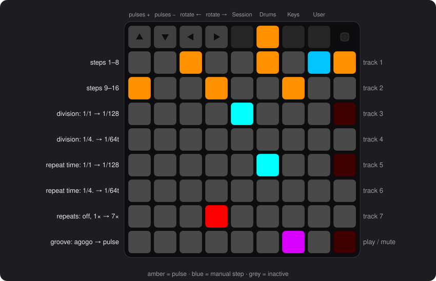

The top two rows are the pattern of the selected track: steps 1–8 on the top row, 9–16 below. Below them, each row is a parameter and the lit pad is the current value.

| Row | What it sets |
|---|---|
| Steps 1–16 | The pattern (see below) |
| Division, straight | The track's own clock, 1/1 (left) to 1/128 (right) |
| Division, dotted and triplet | 1/4., 1/8., 1/16., 1/32., then 1/8t, 1/16t, 1/32t, 1/64t |
| Repeat time, straight / dotted and triplet | Spacing of the repeats, same values as the division |
| Repeats | Extra hits after each step: off, 1× … 7× |
| Groove | Accent groove shape: agogo, timbales, congas, bongo, saw, triangle, sine, pulse |

### The pattern

- The pattern is **Euclidean**: *pulses* spread as evenly as possible over *length* steps, then shifted by *rotation*. Pulses are amber.
- **Tap a step pad** to set the track's **length** to that step (tap pad 12 for a 12-step pattern). Steps beyond the length go dark. The pulse count never exceeds the length.
- **↑ / ↓** add or remove a pulse. **← / →** rotate the pattern.
- While playing, the **playhead** lightens each pad it passes, pulse or not. An **accented** step is also paler.
- A step is only ever *added* to the Euclidean pattern, never removed: if you want a different rhythm, change pulses or rotation, or add manual steps (below).

### Editing a step

**Hold a step pad** (about half a second) to select it. Its pad blinks, and the screen switches to the *step* sub-page. This sub-page is special: E1 cannot reach it or leave it, it is there for as long as a step is selected. Its marker at the top right (the first one) turns from a single pixel into a white square that blinks together with the step's pad, as a reminder of why the screen is locked.

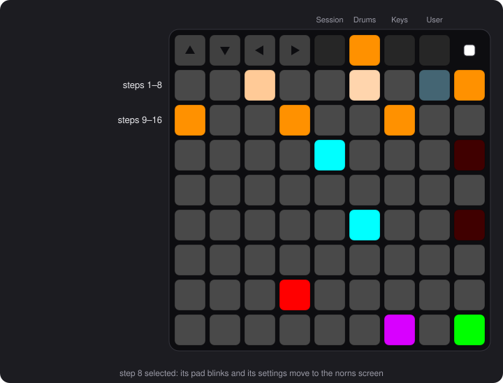

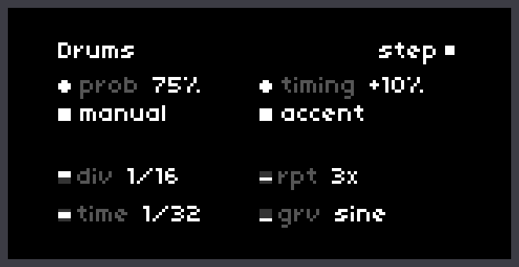

| Control | What it does |
|---|---|
| E2 `prob` | Probability that the step plays, 0–100% |
| E3 `timing` | Delay of the step, 0–90% of the track's division (it can only be late, never early) |
| K3 `accent` | Accent: a louder hit (see `accent+` below). The pad turns brighter |
| K2 `manual` | Turns the step into a hand-placed (light blue) step, or off again. Only available on a step that is not already an amber pulse |

Settings of an amber pulse follow **that pulse**, not the pad: if you change length, pulses or rotation, its accent, probability and timing move with it. Manual steps keep their own.

**Tap any step pad** to deselect the step: the screen goes back to *velocity*. **Hold another step pad** to jump straight to it. Touching a pad of the **repeats** or **groove** rows also leaves step editing, and jumps to the matching sub-page.

### Screen sub-pages

E1 cycles through three sub-pages: *velocity* (the default), *repeat* and *groove*. Touching a pad of the **repeats** row jumps to *repeat*, and touching a pad of the **groove** row jumps to *groove*, even if the pad you touch is already the selected one. The *step* sub-page is described above.

| Sub-page | E2 | E3 |
|---|---|---|
| *velocity* | `velocity`: base velocity, 0–127 | `accent+`: velocity added to accented hits |
| *repeat* | `ramp`: velocity slope across the repeats, −63…63 | `pace`: speeding up (+) or slowing down (−) of the repeats |
| *groove* | `amount`: how strongly the groove shapes velocity, 0–127 | `length`: length of the groove cycle in bars (1…64) |

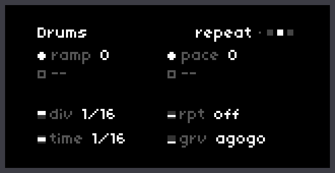
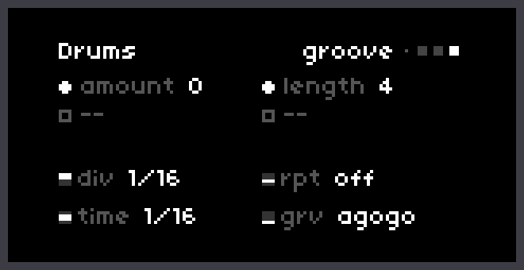

### Repeats

The **repeats** row adds extra hits after each step, spaced by the **repeat time** rows. **Ramp** makes them louder or softer along the series; **pace** makes them accelerate or slow down. A new step is not blocked by repeats still sounding; stopping the sequencer cuts them.

### Groove

The groove is a slow velocity curve laid over the track: the hit's velocity is shifted up and down by the selected shape (`sine`, `saw`, `triangle`, `pulse`, or one of four percussion-style patterns) times `amount`. The cycle lasts `length` bars. All tracks share the same phase.

## Keys page

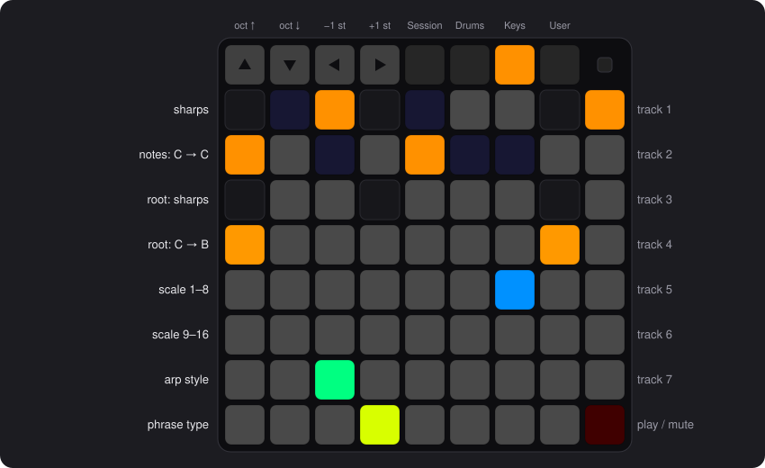

From top to bottom:

| Row | What it does |
|---|---|
| Notes, sharps (top) and naturals | The **chord** the track plays: tap pads to add or remove notes. The two rows are a one-octave keyboard (C … C); sharps sit on the top row. Notes outside the scale are dark and cannot be added |
| Root | The root of the scale (two rows, same layout as the keyboard) |
| Scale 1–8 / 9–16 | The scale: chromatic, major, dorian, phrygian, lydian, mixolydian, minor, locrian, harmonic minor, melodic minor, major pentatonic, minor pentatonic, blues, whole tone, in sen, hirajoshi |
| Arp style | up, down, up-down, down-up, random, as played, converge, diverge |
| Phrase type | static, rise, fall, arch, valley, zigzag, random walk, cascade |

- Changing the root or the scale moves the selected notes to the nearest note in the new scale, so the chord always stays in key.
- **↑ / ↓** move the keyboard view by an octave (the chord does not change). **← / →** transpose the whole chord by a semitone.

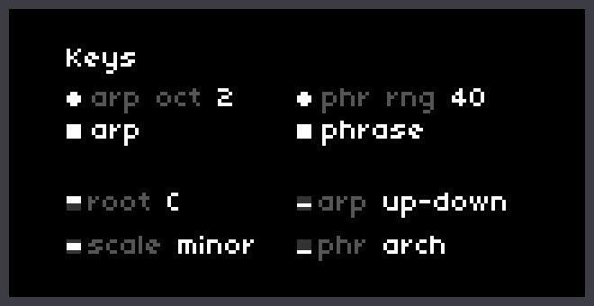

| Control | What it does |
|---|---|
| K2 `arp` | Arpeggiator on/off |
| E2 `arp oct` | Octaves the arpeggio spans, 1–4 |
| K3 `phrase` | Phrase on/off |
| E3 `phr rng` | How far the phrase moves the pitch, 0–127 (up to an octave) |

### Arp

With the arp on, a step no longer plays the whole chord: it plays a burst of notes walking through the chord in the chosen style. The burst reuses the **repeat** controls from the Drums page: `repeats` sets how many extra notes it has (1 + repeats in all), the repeat time sets its speed, ramp and pace shape it. The position in the arpeggio carries on from step to step.

### Phrase

A phrase is a melodic contour laid over the track's own pattern: the played pitch is shifted up and down following the chosen shape, scaled by the range, and then brought back into the scale.

## User page

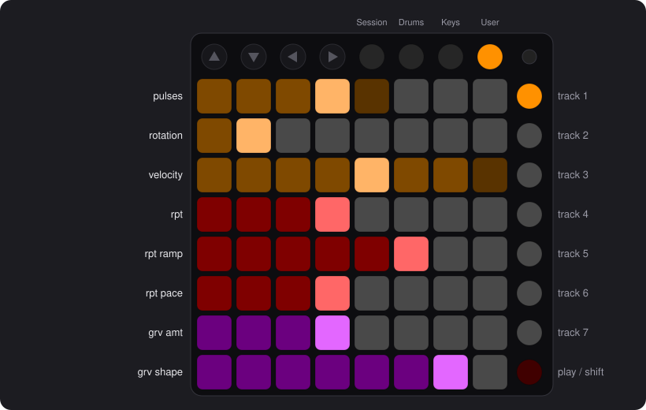

Eight rows, eight parameters that can be **modulated randomly**:

| Row | Parameter |
|---|---|
| 1 | `pulses` |
| 2 | `rotation` |
| 3 | `velocity` |
| 4 | `rpt` (repeat count) |
| 5 | `rpt ramp` |
| 6 | `rpt pace` |
| 7 | `grv amt` (groove amount) |
| 8 | `grv shape` (groove shape) |

Each row is a fader that **shows** the parameter's value live. Setting the value is done where the parameter lives (Drums, arrows…); the faders only display it. In a row: the bright pad is the **live value**, the filled part is the **value you dialled in**, and a dim halo shows how far the modulation can swing.

**Touch a row** to select it (its bright pad blinks). Until you do, the screen says `touch a row`. It then configures that parameter's modulation:

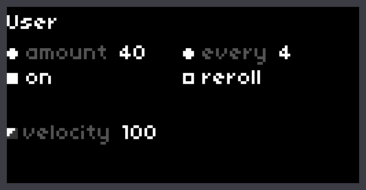

| Control | What it does |
|---|---|
| K2 `on` | Modulation on/off. Turning it off puts the dialled-in value back |
| E2 `amount` | Depth of the modulation, 0–127 |
| E3 `every` | The modulation changes every 1, 2, 4, 8, 16 or 32 steps of the track |
| K3 `reroll` | Draws a new random sequence |

The modulation follows a sequence of 16 random values that loops, so it sounds like a pattern rather than noise. Each parameter of each track has its own, and they all run at once. The sequence stays the same until you press **reroll**: every play starts it over from the beginning, and it is stored with the pattern (so it survives pattern switches and psets). If you change the parameter by hand while its modulation is on, the modulation swings around the new value.

## Session page

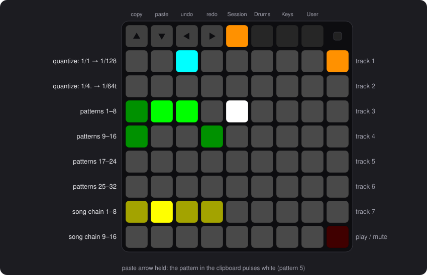

In this picture pattern 2 (bright green) is playing and pattern 3 (dark green) is queued: its pad pulses until the change happens. The white pad is the copied pattern shown while the paste arrow is held; it pulses too.

Each track holds **32 patterns**. A pattern stores everything about the track's rhythm and melody (pattern, division, repeats, groove, notes, scale, arp, phrase, modulation settings, velocity). It does **not** store the track's voice or mute.

There is no *save* button: the active pattern always follows what you do, and switching saves it.

| Rows | What they are |
|---|---|
| Quantize / length (two rows) | When patterns change (see [below](#when-patterns-change)): bars on the top row, loops of the pattern on the second |
| Patterns 1–32 (four rows) | Dim green = has content, bright green = loaded |
| Song chain (two rows) | 16 positions |

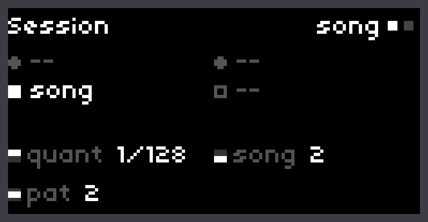

**E1** switches between the two sub-pages of the Session page, **song** and **chain**. As on the Drums page, the lower half of the screen never changes: it shows the values of the pad rows (`quant`, `pat`, `song`). The upper half is what the sub-pages swap.

- **song**: **K2 `song`** turns the song chain on.
- **chain**: the whole song chain, as two rows of eight pattern numbers in the same order as its pads (positions 1–8 on top). The position being played is bright, empty positions are a dim dash. An armed position blinks, like its pad, and the `song` value below then reads `position -> pattern` (for example `9 -> 3`, or `9 -> --` when the position is empty).

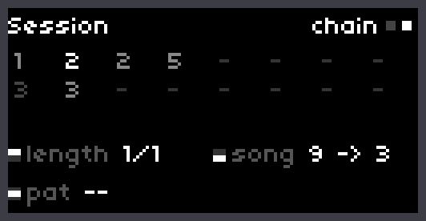

Position 2 (bright) is the one playing; position 9 (dimmer) is armed and blinks.

### Switching patterns

**Tap a pattern** to switch to it (an empty slot starts a blank pattern). While playing, the change waits for the next **quantize** boundary and the pad blinks until then. When stopped, it is immediate. Tapping the pattern that is already loaded does nothing, and in song mode tapping a pattern does nothing either: the chain decides.

### Copy, paste, delete

The four arrows of the top row work on patterns on this page.

| Gesture | What it does |
|---|---|
| **Hold ▲**, tap a pattern | **Copies** it into the clipboard. Its pad flashes white briefly to confirm |
| **Hold ▼**, tap a pattern | **Pastes** the clipboard into it, replacing what it held. While ▼ is held, the pattern in the clipboard pulses white, so you can see what you are about to paste. Pasting into the loaded pattern replaces the track's current state at once |
| **Hold a pattern** | Arms its **deletion**: the pad pulses red. **Tap it** to delete it, **tap anywhere else** to cancel (that tap does nothing else). Any pattern with content can be deleted |
| **◀** | **Undo** |
| **▶** | **Redo** |

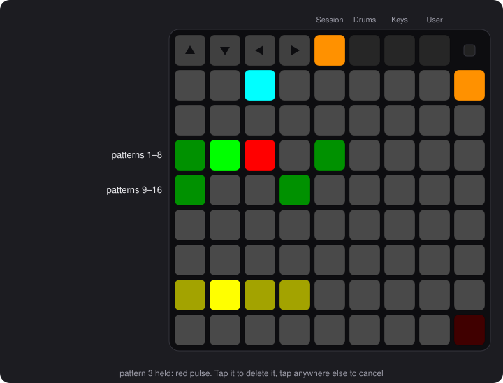

- The clipboard is shared by the seven tracks: copy on one track, select another, and paste.
- Deleting the loaded pattern empties it: it stays loaded as a blank pattern.
- **Undo and redo** cover pasting, deleting and editing the song chain, with the last 16 actions of each track. Switching pattern and the settings of the other pages are not in the history. It starts empty when you load a pset.

### Song chain

The chain plays patterns in order, on its own for each track.

- **Tap a chain position** to arm it (it blinks white), then **tap a pattern** to put it there. If the position already holds a pattern, that pattern's pad pulses white while the position is armed, so you can see what is there.
- **Hold a chain position** to clear it.
- Both can be undone with ◀.
- **K2 `song`** turns the chain on. It then advances through the filled positions, skipping empty ones, and goes round the 16 positions in a loop. Each position lasts the song's **length** (see below). Gaps are fine, and so is filling only the second row. An empty chain does nothing. The playing position is bright yellow.
- A pattern that appears twice in a row keeps playing, it is not restarted. To make a part last longer, put the same pattern on several positions.

### When patterns change

The two rows below the top of the Session page set **when** patterns change. It is one setting with two uses, and the pads follow the mode:

| Mode | The setting is called | It decides |
|---|---|---|
| Song **off** | `quant` (quantize) | When a pattern you tap takes effect |
| Song **on** | `length` | How long each position of the song chain lasts |

The two values are independent: each track remembers its own `quant` and its own `length`, and the same pads show whichever applies. The screen label changes with the mode.

| Row | Unit | Values (left to right) |
|---|---|---|
| Top | Bars, on the clock shared by all tracks | `1/16` (one step), `1/4` (a beat), `1/2` (half a bar), `1/1` (one bar), `2/1`, `4/1`, `8/1`, `16/1` bars |
| Second | **Loops of the track's own pattern** | `1x`, `2x`, `3x`, `4x`, `6x`, `8x`, `12x`, `16x` |

- A value in **bars** keeps all tracks on the same bar lines, whatever their lengths.
- A value in **loops** waits for the track's pattern to finish a whole number of loops, so a pattern of 5 steps is never cut halfway. Each track changes at its own loop end. A muted track waits, since its pattern is paused.
- Examples: with `quant 1/1`, a pattern you tap starts at the next bar. With song on and `length 2x`, each chain position plays its pattern twice, whatever its length.
- Defaults: `quant 1/16` (almost immediate) and `length 1/1`.

## Playing: tracks, mute, tempo

- **Select a track**: tap its button in the right column.
- **Play / stop**: tap the bottom button of the right column (stopping rewinds all tracks).
- **Hold the bottom button** (*Stop Solo Mute*). While it is held:
  - **tap a track button** to latch its **mute** (the button turns red; tap again to unmute);
  - **hold a track button** to mute it only while you hold it (a momentary mute);
  - **turn E2** to change the **tempo**; the screen shows it. Letting go after muting or changing the tempo does not toggle play.

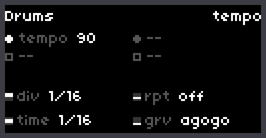

## Saving

orbits saves with the norns **PSET** system (**PARAMETERS > PSET**). A pset keeps the voice of each track, the tempo, **all patterns** of the 7 tracks, the song chains and the quantize and length settings. It writes an extra file `<pset>.orbitsdata` next to the pset; keep the two together.

What is not saved: the current page, the selected track and mutes.

## Voices and MIDI

Each track sends its notes to a voice, chosen in **PARAMETERS** with **T1 OUTPUT … T7 OUTPUT**. The voice system is [nb](https://github.com/sixolet/nb), and orbits bundles it: you do not need to install it.

- **MIDI**: every connected MIDI port appears as a voice, named `midi: <port> <n>`, with its channel, modulation CC and bend range in the parameters. This works out of the box.
- **Internal synths**: any [nb](https://github.com/sixolet/nb) voice mod you have installed shows up in the same list.

The script only sends note on / note off with a velocity. Notes are short gates.

## Reference

### Divisions

| Straight (row 1) | 1/1 | 1/2 | 1/4 | 1/8 | 1/16 | 1/32 | 1/64 | 1/128 |
|---|---|---|---|---|---|---|---|---|
| **Dotted / triplet (row 2)** | 1/4. | 1/8. | 1/16. | 1/32. | 1/8t | 1/16t | 1/32t | 1/64t |

The default division is 1/16, the default pattern is 4 pulses on 8 steps, the default note is C2.

### Pad shortcuts

| Gesture | Result |
|---|---|
| Tap a step (nothing selected) | Pattern length = that step |
| Hold a step | Edit that step (the screen locks on the *step* sub-page) |
| ↑ ↓ ← → on Drums | Pulses +/− , rotation ←/→ |
| ↑ ↓ ← → on Keys | Octave view up/down, chord transpose −/+ semitone |
| Tap a track button | Select the track |
| Hold play/mute, tap a track | Latch mute |
| Hold play/mute, hold a track | Momentary mute |
| Hold play/mute, turn E2 | Tempo |
| Tap a pattern | Switch (at the quantize boundary) |
| Hold ▲, tap a pattern | Copy it (Session page) |
| Hold ▼, tap a pattern | Paste the copy there |
| Hold a pattern, tap it again | Delete it (tap elsewhere to cancel) |
| ◀ / ▶ on Session | Undo / redo |
| Tap a chain position, tap a pattern | Fill that position |
| Hold a chain position | Clear it |

## Troubleshooting

- **A cross (✕) at the top of the screen, between the page name and the sub-page name** (see below): the Launchpad is not connected. Plug it in; orbits connects as soon as it appears. If it never does, check that the **LP3** mod is enabled in **SYSTEM > MODS** and that you restarted the norns after enabling it.

  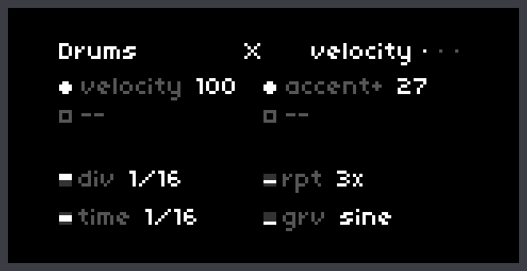

- **No sound**: check that the track has a voice (**T… OUTPUT** in PARAMETERS), that it is not muted (red button) and that its pulses are not 0.

## Contributing

The code is split into small modules. [docs/ARCHITECTURE.md](docs/ARCHITECTURE.md) explains how the script is built and which file to edit for what. The pictures in this README are generated from the real code with `tools/render.sh`, so they stay accurate when the script changes.
